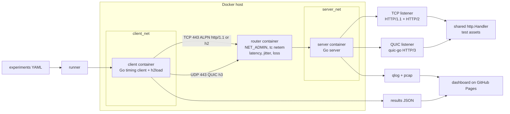
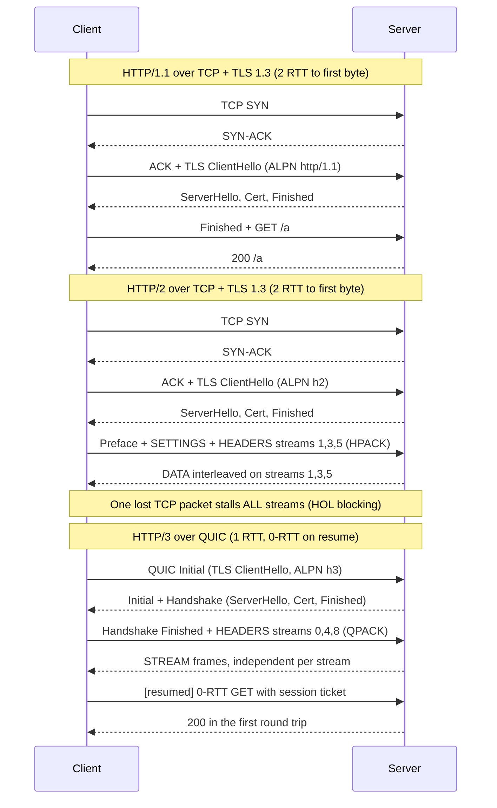

# http-protocol-lab

A Go + Docker test bed that serves identical content over **HTTP/1.1**, **HTTP/2**, and **HTTP/3 (QUIC)**, then measures what actually changes between them under controlled latency, jitter, and packet loss.

## Architecture



## Handshakes: HTTP/1.1 vs HTTP/2 vs HTTP/3



Editable versions live in Lucid; sources are in [`docs/diagrams/`](docs/diagrams/).

## Repo layout

| Path | Purpose |
|---|---|
| `server/` | Go server: TCP (h1/h2) + QUIC (h3) listeners, shared handler, qlog |
| `client/` | Go timing client (DNS, connect, TLS, TTFB, total) |
| `lab/` | Docker Compose topology + netem profiles |
| `experiments/` | YAML experiment definitions |
| `results/` | Summary JSON consumed by the dashboard |
| `dashboard/` | Static charts site (GitHub Pages) |
| `docs/` | Diagrams and write-ups |
| `certs/` | mkcert-generated local TLS certs (gitignored) |

## Planned experiments

| Experiment | Demonstrates |
|---|---|
| 100 small assets, 0% loss, 50 ms RTT | Multiplexing vs HTTP/1.1 connection limits |
| Same at 1-5% loss | TCP head-of-line blocking vs QUIC per-stream loss |
| Cold connect, 150 ms RTT | Handshake round trips |
| 0-RTT resumption | QUIC early data |
| Repeated large headers | HPACK vs QPACK compression |
| Client IP change mid-transfer | QUIC connection migration |
| 100 MB bulk download | Throughput and CPU cost |

## Roadmap

- [ ] M1: Single server speaking h1/h2/h3, verified with curl
- [ ] M2: Netem lab + h2load runner
- [ ] M3: Custom timing client to JSON
- [ ] M4: Dashboard + findings write-ups
- [ ] M5: pcap/qlog visualizations + CI benchmark runs

## Quick start (WIP)

```sh
make certs
make lab-up
```
